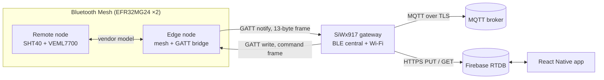

---
# Written from the repo README (2026-10-23). Senior design, built solo after
# the teammate dropped the course. Published without a cover; add a hardware
# photo as `cover` when you have one.
title: BLE Mesh Sensor Network
slug: ble-mesh
tagline: Bluetooth Mesh sensors to the cloud and back, from silicon to phone
tags: [C, FreeRTOS, Bluetooth Mesh, Silicon Labs, MQTT, Firebase, React Native]
role: Senior design. Built solo after my teammate dropped the course
dates:
  start: 2026-04
  end: 2026-06
status: complete
links:
  source: https://github.com/newwavejacob-web/Sensor-Mesh
  video: https://www.youtube.com/watch?v=PuSSsGJGB6g
video:
  embed: https://www.youtube-nocookie.com/embed/PuSSsGJGB6g
  title: Demo and walkthrough of the sensor mesh running end to end
next:
  - Check the SHT40's CRC-8 on every read.
  - Replace HTTPS command polling with an MQTT subscription or Firebase streaming.
  - Add Low Power Node / Friend support for battery-powered sensors, and scale past two nodes.
  - Lock down the Firebase database with Auth and security rules.
draft: false
---

## Overview

A Bluetooth Mesh network of Silicon Labs EFR32MG24 sensor nodes reads temperature, humidity, and light. A SiWx917 Wi-Fi gateway carries the readings to an MQTT broker and Firebase over TLS, and a React Native app shows them live. Commands go the other way too: a button in the app can blink an LED on a board that's only reachable through the mesh. The firmware started from Silicon Labs example applications. The sensor drivers, vendor model, GATT bridge, gateway logic, cloud uplink, and app were written for this project.

## Architecture

Each MG24 node samples an SHT40 and a VEML7700 in its own FreeRTOS task. The remote node publishes readings over a custom Bluetooth Mesh vendor model. The edge node is a mesh node and a BLE peripheral at the same time: it streams its own readings and the relayed ones through a custom GATT service. The SiWx917 connects to that service as a BLE central, publishes JSON telemetry over MQTT, writes it to Firebase, and polls Firebase for commands to send back down.

## What I built

Every layer. It started as a team project, but my teammate dropped the course, so I built the whole system:

- Bare-metal I²C drivers for both sensors using integer-only math, and a mutex-protected sample cache.
- A custom Bluetooth Mesh vendor model (company `0x02FF`, model `0x1234`) with four opcodes, shared by both nodes.
- The GATT bridge service on the edge node, and the binary sensor and command frame formats.
- The SiWx917 gateway: BLE discovery and decoding, MQTT 3.1.1 over TLS with a Last Will, Firebase HTTPS, and the command relay.
- The Expo (React Native) dashboard with live node cards and Arm, Blink, and Set-interval controls.

## Hard problems & decisions

### One radio, two roles

The edge node is a mesh node and a GATT peripheral at the same time. The bridge advertises on its own advertising set, separate from the mesh proxy's, and stack events are routed so the mesh, proxy, and bridge handlers each see the ones they need.

### Telling BLE peers apart

A phone acting as a mesh proxy and the SiWx917 gateway can both connect to the edge node. Connection order isn't reliable, so the bridge treats whichever connection subscribes to the sensor characteristic as the gateway.

### No floats on the sensor path

All sensor math is 64-bit integer math in milli-units: milli-°C, milli-percent, and centi-lux. That keeps soft-float out of the MG24 image and makes the wire format exact. Conversion to floating point happens only on the SiWx917, which has an FPU.

### One source file, two firmware images

`vendor.c` declares `bridge_publish_sample()` as a weak symbol. On the remote node it's a no-op. On the edge node, `bridge.c` overrides it at link time to forward mesh readings to the gateway. The same file builds into both images with no `#ifdef`s.

### Commands run exactly once

The gateway polls Firebase for commands, runs each one, then clears it. A slow poll can't run the same command twice. The UUID tables are stored little-endian because that's the order the SiWx917 stack reports them in, even though Simplicity Studio shows them big-endian.

## Results

The full loop runs on real hardware: sensor readings travel node → mesh → gateway → MQTT and Firebase → phone, and app commands travel back down to a node that's only reachable over the mesh. The demo video shows it running end to end.
