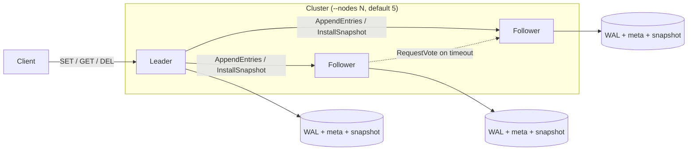

---
# Written from the local wire-up-wal-raft branch (2026-10-23). Five of those
# commits aren't pushed yet, and GitHub's default branch is main, so push and
# merge before publishing or the page describes code nobody can see.
# Replace the placeholder images, then set `draft: false`.
title: HealthDB
slug: healthdb
tagline: Distributed key-value store on Raft, written in Rust
tags: [Rust, Tokio, Raft, Distributed Systems]
role: Solo project. Design, implementation, and testing
dates:
  start: 2025-11
status: in-progress
links:
  source: https://github.com/newwavejacob-web/HealthDB
cover:
  src: ../../assets/projects/healthdb/cover.png
  alt: HealthDB title card (placeholder)
gallery:
  - src: ../../assets/projects/healthdb/leader-election.png
    alt: Terminal output from scripts/failover-demo.sh on a 5-node cluster (placeholder)
    caption: scripts/failover-demo.sh kills the leader of a 5-node cluster, waits for a new one, and checks that the committed value survived.
  - src: ../../assets/projects/healthdb/wal-recovery.png
    alt: Log output from a node restoring its snapshot and replaying its WAL tail (placeholder)
    caption: After a kill -9 of the whole cluster, each node loads its snapshot, replays its WAL tail, and the data is back.
# video:
#   embed: https://www.youtube-nocookie.com/embed/<id>
#   title: 5-node cluster surviving a leader failure
next:
  - Finish TLS for node-to-node RPCs and the client listener (in progress with tokio-rustls).
  - Forward client writes to the leader instead of rejecting them on followers.
  - Cluster membership changes (adding and removing nodes while running).
  - Benchmark throughput and failover time, and publish the numbers.
draft: true
---

## Overview

HealthDB is a distributed key-value store in Rust that keeps a replicated log consistent across a cluster using Raft, implemented directly from the paper. Nodes elect a leader, the leader replicates writes and commits them once a majority has them, and every node persists its log, term, and vote so it can be killed at any moment and come back with its data. I built it to understand consensus from first principles rather than through a library.

## Architecture

Each node is one Tokio process with four parts:

- **Raft core:** term, role, log, commit index, and a randomized election deadline.
- **RPC layer:** bincode messages with a length prefix over TCP. Each attempt has a 30 ms timeout and up to 3 retries with exponential backoff, and RPCs go to all peers concurrently.
- **Storage:** an fsynced write-ahead log whose records carry their index, term, and a CRC32. A small `meta` file holds `currentTerm`, `votedFor`, and `commitIndex`. A snapshot file holds the compacted store.
- **State machine:** an in-memory `HashMap` that committed entries are applied to, served over a Redis-style text protocol.

## What I built

All of it. This is a solo project:

- Leader election, log replication, commit-index advancement, and applying committed entries.
- Crash-safe persistence: the WAL, the `meta` file written with temp file + fsync + rename + directory fsync, and log reload on restart.
- Snapshotting: log compaction every 1,000 applied entries (`--snapshot-every`), `InstallSnapshot` for followers that fall behind, and snapshot + WAL-tail recovery.
- The async RPC layer with timeouts, retries, and concurrent broadcast.
- Kill-and-restart tests, and shell scripts that run a local N-node cluster, kill the leader, kill -9 every node, and check that the data survives.

## Hard problems & decisions

### Committed data vanished after failover

The first version of the 5-node failover script wrote a key, killed the leader, and read the key back from the new leader. It got `NIL`. A new leader can't tell whether entries from earlier terms are committed until it commits something in its own term (Raft §8). Now a new leader appends a no-op entry as soon as it's elected, which commits everything before it.

### Election livelock after a full restart

After restarting the whole cluster, no leader was ever elected. Every incoming RPC reset the election timer, and timeouts were deterministic (150 ms + 50 ms × node ID). The node with the shortest timeout had a stale log, so it kept calling elections it could never win, and each failed vote request reset everyone else's timer. The fix follows Raft §5.2: the deadline resets only on a valid AppendEntries or a granted vote, and timeouts are random between 300 and 600 ms.

### Making the state survive kill -9

A node that forgets its vote can vote twice in one term and elect two leaders. `currentTerm` and `votedFor` are written durably before any reply goes out. WAL appends are fsynced, a torn or corrupt tail is cut off on reload, and every log change goes through one function so the in-memory log and the WAL can't drift apart. WAL records carry their log index, so a crash between writing a snapshot and rewriting the WAL just skips the entries the snapshot already covers.

### Retries that fit inside a heartbeat

Retrying a dead peer can delay heartbeats to live peers and trigger needless elections. Each attempt gets 30 ms with backoff of 5 then 10 ms, so the worst case is about 105 ms, inside one 125 ms heartbeat interval. Sending to all peers concurrently means one dead node costs a round one retry budget, not one per peer.

## Results

A 5-node local cluster elects a leader, survives the leader being killed with no committed writes lost, keeps accepting writes with 4 of 5 nodes up, and recovers all data after every node is killed with `kill -9` and restarted. `scripts/failover-demo.sh` and `scripts/snapshot-demo.sh` check this end to end and exit non-zero on any failure. Unit tests cover persistence, truncation, torn tails, compaction, crash mid-compaction, and snapshot install.
