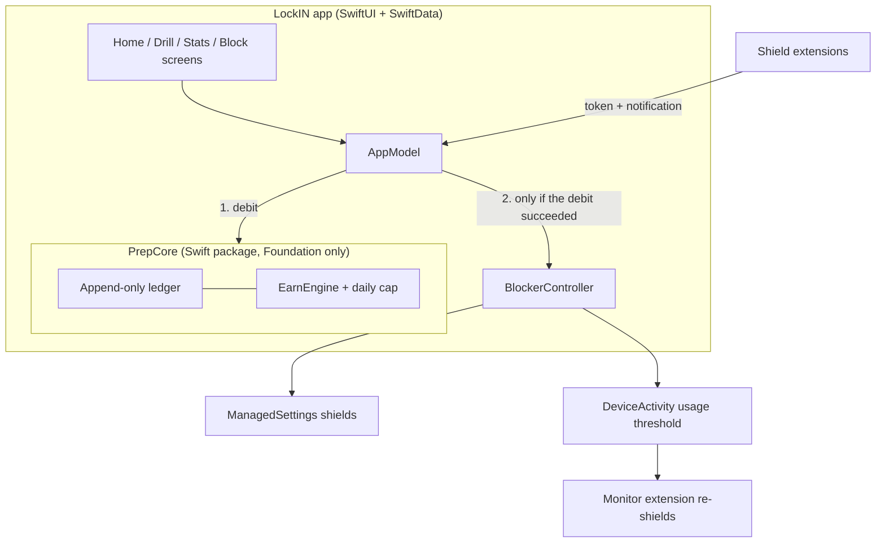

---
# Written from the local README (2026-10-23). Replace the placeholder images
# with device screenshots, add the demo video when it exists, then set
# `draft: false`.
title: LockIN
slug: lockin
tagline: Study-to-unlock iOS app built on Screen Time
tags: [Swift, SwiftUI, SwiftData, FamilyControls, DeviceActivity, XCTest]
role: Solo project. Design, iOS app, extensions, and tests
dates:
  start: 2026-06
status: in-progress
links:
  source: https://github.com/newwavejacob-web/LockIN
cover:
  src: ../../assets/projects/lockin/cover.png
  alt: LockIN title card (placeholder)
gallery:
  - src: ../../assets/projects/lockin/shield.png
    alt: The branded LockIN shield covering a blocked app (placeholder)
    caption: A blocked app shows LockIN's own shield. Its button hands the app off to LockIN through a notification.
  - src: ../../assets/projects/lockin/drill.png
    alt: The rolling GRE drill with the banked-minutes header (placeholder)
    caption: The rolling drill. Each correct answer banks seconds right away, weighted toward your weakest topics.
# video:
#   embed: https://www.youtube-nocookie.com/embed/<id>
#   title: Shield → drill → spend → automatic relock on a real device
next:
  - Finish the on-device verification pass for the branded shield and per-app usage unlocks.
  - First-run onboarding, a settings screen for the economy tunables, and a larger question bank (more GRE, then SAT and LSAT).
  - Request Apple's Family Controls distribution entitlement for all four bundle IDs, then ship a TestFlight build.
draft: false
---

## Overview

LockIN is a native iOS app that puts your distracting apps behind iOS Screen Time and makes you study to get them back. Answering GRE questions correctly banks unlock minutes. You spend them on one app at a time, and the app locks itself again once you've used it for that long. The OS enforces the locks, so they survive killing the app and rebooting the phone.

## Architecture

The app has three layers, and dependencies only point inward. **PrepCore** is a Swift package that imports no system frameworks: questions, grading, the append-only ledger, the earn engine, and the unlock controller, covered by 30 XCTest cases. The **app** (SwiftUI and SwiftData) talks to one `AppModel` object. The **blocker** layer holds all the Screen Time code: the app's `BlockerController` plus three extensions, a Device Activity Monitor and two shield extensions.

## What I built

Everything. This is a solo project:

- PrepCore: the ledger, the difficulty-scaled earn engine with its daily cap, the unlock controller with spend and refund, stats, and the 30 tests.
- The SwiftUI app: a rolling drill that favors weak topics, a stats screen, and the redeem flow built around the app you tapped.
- Screen Time integration: per-app shields, usage-based relocks, and a reconcile pass that runs every time the app comes to the foreground.
- The branded shield and the shield → drill handoff through App Group storage and a local notification.

## Hard problems & decisions

### Debit first, touch the OS second

Spending minutes has two steps that can fail independently: the ledger debit and the OS unlock. LockIN always debits first and lifts a shield only if the debit succeeded. If the OS then refuses to schedule the relock, the debit is refunded against the same session ID. The two can never disagree in the user's favor.

### The balance is derived, never stored

The balance is the sum of an append-only ledger. Each entry also stores the balance after it, used for O(1) reads and as an integrity check. An append-only log means the app and an extension can both add entries without losing updates. The daily cap clamps the sum of the day's earnings, so the question that crosses the cap gets partial credit and later answers earn nothing.

### iOS never says how much time is left

Relocks use a `DeviceActivity` usage threshold, so the clock only runs while the app is actually open. iOS has no API that reports progress toward a threshold, which forced two decisions. The UI says "relocks after N min of use" instead of showing a countdown. And "Lock now" forfeits unused time, because there's no honest way to compute a partial refund.

### The OS callbacks are unreliable

`intervalDidEnd` sometimes fires late or not at all, and `eventDidReachThreshold` is flaky on some iOS 26 builds. Every time the app comes to the foreground, it re-reads the unlock records from the App Group and re-shields anything whose activity has ended or whose end-of-day safety deadline has passed. That reconcile is the real guarantee; the extension callbacks are best effort.

### Extensions can't open the app

iOS gives shield extensions no supported way to launch their parent app. The shield button saves the blocked app's token to App Group storage and posts a local notification. Tapping it, or opening LockIN within 30 minutes, goes straight into the drill with that app as the target.

## Results

The study and economy core is finished, with 30 passing XCTest cases. Locking, redeeming, and automatic relock were verified on a physical device on 2026-07-02. The branded shield, the shield → drill handoff, and per-app usage unlocks are built and compile; verifying them on a device is the next step. Nobody else can install it yet: Family Controls apps need a distribution entitlement that Apple grants by hand for each bundle ID, and that hasn't been requested yet.
