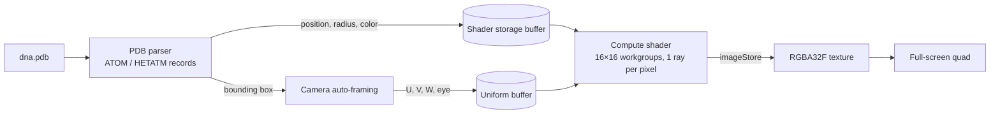

---
# Written from the MOLE-Renderer repo (2026-10-23). The repo was renamed from
# Learning_OpenGL. If this started as a course assignment, say so in `role`.
# Replace the placeholder cover with a render of dna.pdb, then set
# `draft: false`.
title: Molecule Ray Tracer
slug: molecule-ray-tracer
tagline: GPU ray tracing for PDB molecular structures with compute shaders
tags: [C++, OpenGL 4.6, GLSL, Compute Shaders]
role: Solo project
dates:
  start: 2026-09
status: in-progress
links:
  source: https://github.com/newwavejacob-web/MOLE-Renderer
cover:
  src: ../../assets/projects/molecule-ray-tracer/cover.png
  alt: A DNA molecule rendered as colored spheres (placeholder)
next:
  - A bounding volume hierarchy over the atoms, so each ray tests a handful of spheres instead of all of them.
  - Phong highlights and shadow rays for depth.
  - Clean up the leftover LearnOpenGL assets and add build steps and a screenshot to the README.
draft: false
---

## Overview

MOLE renders molecules from Protein Data Bank (PDB) files by ray tracing them on the GPU. It parses each atom's position and element, uploads the atoms as spheres in a storage buffer, and uses an OpenGL compute shader to cast one ray per pixel. Atoms use CPK colors and van der Waals radii, and the camera frames the molecule automatically from its bounding box.

## Architecture

The CPU side is C++ with GLFW and GLAD. The parser reads the fixed-width columns of each `ATOM` and `HETATM` record. If the element column is empty, it falls back to the atom name. It also tracks the molecule's bounding box as it reads. Each frame, the camera basis goes to a uniform buffer, the compute shader writes the image to a texture, and a simple vertex and fragment shader pair draws that texture on a full-screen quad.

## What I built

All of it, starting from a LearnOpenGL walkthrough project:

- The PDB parser with per-element radii and colors, and a bounding box computed while parsing.
- The compute-shader ray tracer: ray generation from the camera basis, ray-sphere intersection, closest-hit tracking, and diffuse shading.
- The GPU plumbing: storage buffer, uniform buffer, image load/store, and the display quad.
- A camera that starts out framing the whole molecule, with mouse and scroll controls.

## Hard problems & decisions

### Compute shader instead of rasterizing spheres

Rasterizing thousands of atoms means building a triangle mesh for every sphere. Ray tracing in a compute shader intersects each sphere analytically, so every atom is a single `vec4` (center plus radius) and edges are smooth at any zoom. The cost is that each pixel currently tests every atom.

### Where to put the camera

PDB coordinates are in ångströms around an arbitrary origin, so a fixed camera usually points at empty space. The parser computes the molecule's bounding box as it reads. The camera then starts looking at the center, backed off 2.5 times the bounding radius so the whole molecule is in view.

## Results

It loads `dna.pdb` and renders the molecule as shaded, element-colored spheres in real time with a movable camera. Rendering is still brute force: every ray tests every atom. The next step is a bounding volume hierarchy so larger proteins stay interactive.
