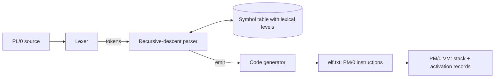

## Overview

A complete compiler for PL/0, a small Pascal-like teaching language, written in C. It turns source code into instructions for the PM/0 stack machine, and comes with a PM/0 virtual machine to run them. It supports constants, variables, nested procedures, recursion, `if`/`while`, and `read`/`write`. It reports clear errors for malformed programs, such as "Undeclared identifier" or "Assignment to constant or procedure isn't allowed".

## Architecture

The compiler runs in one pass. The lexer turns source into tokens. A recursive-descent parser checks the grammar and does semantic checks against a symbol table that tracks each name's kind and lexical level. Code is emitted while parsing. The VM is a separate program that runs the nine-instruction PM/0 set: `LIT`, `OPR`, `LOD`, `STO`, `CAL`, `INC`, `JMP`, `JPC`, and `SYS`.

## What I built

All of it, about 1,300 lines of C:

- The lexer, including comments, reserved words, and length limits on identifiers and numbers.
- The recursive-descent parser with semantic checks and descriptive errors.
- The symbol table with lexical levels, and scope cleanup when a procedure ends.
- The code generator, including backpatching of forward jumps.
- The PM/0 virtual machine, and a Makefile with run, test, debug, release, and valgrind targets.

## Hard problems & decisions

### Variables in enclosing procedures

PL/0 lets a nested procedure use variables from the procedures around it. Each `LOD` and `STO` carries the difference between the current lexical level and the variable's level. At runtime, the VM follows that many static links up the stack to find the right activation record. `CAL` pushes the static link, the dynamic link, and the return address, so recursion and nesting both work.

### Jumping to code that doesn't exist yet

`if`, `while`, and procedure bodies need jumps to addresses that aren't known when the jump is emitted. The code generator emits the jump with a placeholder, remembers its index, and patches in the target once the parser reaches it.

### Scopes in a single pass

When a procedure's body ends, its symbols must stop being visible without losing the outer scope's. Symbols are marked out of scope by lexical level instead of being deleted. Lookups skip marked entries, and duplicate-declaration checks look only at the current level.

## Results

The compiler and VM handle the full PL/0 language: nested procedures, recursion, and all control structures. The compiler writes the generated PM/0 code to `elf.txt`, and the VM prints each instruction and the stack as it runs.
