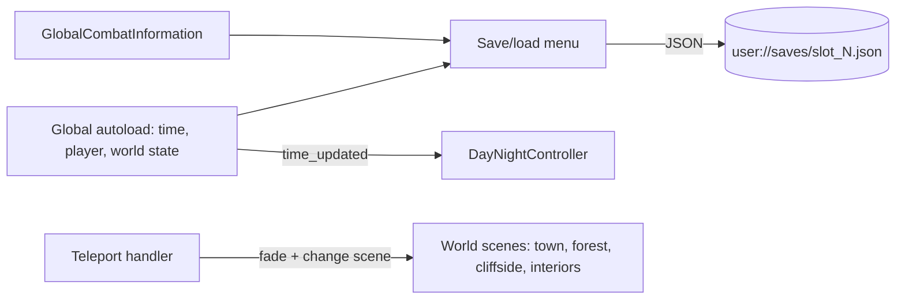

---
# Written from the team repo's git history (2026-10-23). Teammates are listed
# by their git author names. Confirm they're OK being named and check the
# spelling before publishing. seal-bound.com didn't respond on 2026-10-23, so
# it isn't linked. Replace the placeholder cover with a screenshot, then set
# `draft: false`.
title: Sealbound
slug: sealbound
tagline: 2D narrative RPG in Godot, made with a small team
tags: [Godot, GDScript, HTML/CSS, JavaScript]
role: Contributor. Gameplay systems, world collisions, and the official website
team:
  - { name: Gage Lappin }
  - { name: Alisa Katsionova }
  - { name: Jacob Roberts, role: Gameplay systems and website }
dates:
  start: 2026-01
status: in-progress
links:
  source: https://github.com/AlisaK13003/sealbound
  extra:
    - { label: Website source, url: https://github.com/newwavejacob-web/SealBound-Site }
cover:
  src: ../../assets/projects/sealbound/cover.png
  alt: Sealbound title card (placeholder)
next:
  - A browser build on itch.io so anyone can play it in one click.
  - Bring seal-bound.com back up and link the playable build from it.
draft: true
---

## Overview

Sealbound is a 2D narrative RPG built in Godot where you restore the world through connection, not sacrifice. A small team makes it; I'm one of the contributors. I built the save/load system, time-of-day lighting, the teleports between areas, and the dungeon reward screen. I also did much of the world's collisions and draw-order sorting, and built the game's official website.

## Architecture

Game state lives in autoload singletons: `Global` holds the clock, the player, and world state, and `GlobalCombatInformation` holds party and combat data. Systems communicate through signals. The day/night controller listens for `time_updated`. Teleports fade the screen out, swap scenes, and place the player at the matching exit.

## What I built

- **Save/load:** a slot-based menu that writes the world state, combat state, and play time to JSON files in `user://saves/`, and shows each slot's saved location before you load it.
- **Time-of-day lighting:** a controller that blends between dawn, day, dusk, and night colors from the game clock and eases into each change, so loading a save doesn't flash.
- **Teleports and bridges:** a reusable teleport handler with an editor dropdown of destinations (town interiors, forest, cliffside) and a fade between scenes.
- **Dungeon reward screen:** experience, level-ups, gold, and items after a dungeon run.
- **Collisions and Y-sorting** across the town, forest, cliffside, and building interiors, plus a world border, so characters walk behind and in front of objects correctly.
- **The official website:** a static landing page in HTML, CSS, and vanilla JavaScript, served by nginx in Docker.

## Hard problems & decisions

### Saving without breaking the team's work

Save/load touches state that other people own. I collected everything through one `Global.get_save_data()` call plus the combat singleton's own export, instead of reaching into scenes. That way teammates can add state without editing the save menu.

<!-- TODO: one concrete bug or tradeoff from building save/load makes this section stronger. -->

### Draw order in a top-down world

In a top-down 2D game, the player has to appear behind a building's roof but in front of its door. I went area by area (town, forest, cliffside, then building interiors), adding collision shapes and Y-sorting so draw order follows where things stand on the ground.

### Lighting that tracks the clock

The day/night tint is computed from the hour and minute rather than stored. A loaded save gets the right color instantly, and the tween only runs when the clock moves forward.

## Results

My work is part of the game today: 35 commits covering save/load, lighting, teleports, bridges, the reward screen, and the collisions and sorting for every main area. The team is still building the game.
