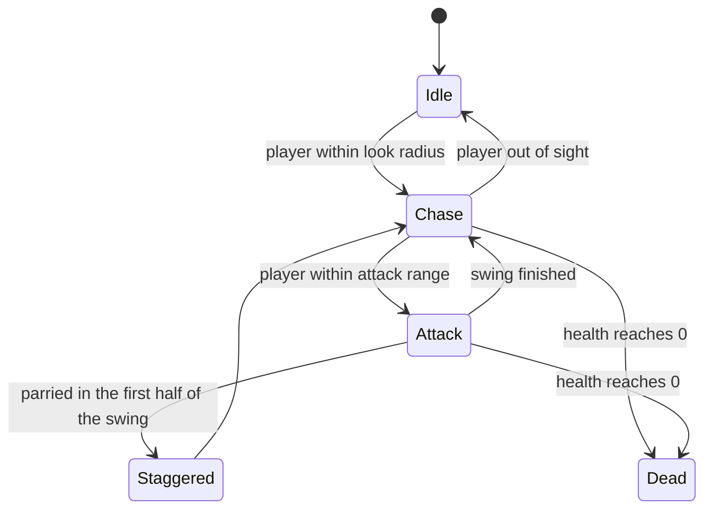

---
# Written from the repo README and scripts (2026-10-23). Confirm the dates and
# that your teammates are OK being named. Replace the placeholder cover with
# a gameplay screenshot (a 60-second clip as `video` is even better), then set
# `draft: false`.
title: Shadow of the Sword
slug: shadow-of-the-sword
tagline: Souls-like dungeon crawler built around parrying
tags: [Unity, C#, Game AI]
role: Enemy AI and gameplay flow, in a team of four (CAP 4053, AI for Game Programming)
team:
  - { name: Megan Murphy }
  - { name: Hunter Davis }
  - { name: Julien Nashi }
  - { name: Jacob Roberts, role: "Enemy AI, combat, and gameplay flow" }
dates:
  start: 2025-01 # TODO: confirm
  end: 2025-04 # TODO: confirm
status: complete
links:
  source: https://github.com/newwavejacob-web/shadow-of-the-sword-4053
cover:
  src: ../../assets/projects/shadow-of-the-sword/cover.png
  alt: Shadow of the Sword title card (placeholder)
next:
  - A Unity WebGL build on itch.io so it can be played in the browser.
  - Sound cues for the parry window, so it isn't purely visual.
draft: true
---

## Overview

Shadow of the Sword is a souls-like dungeon crawler made in Unity by a team of four in one semester, for UCF's AI for Game Programming course. The combat is built on reading enemies: each enemy telegraphs its attacks, and a well-timed parry stops the hit and staggers the enemy. I was largely responsible for the enemy AI and the overall gameplay flow.

## Architecture

Each enemy runs a small state machine every frame. It idles until the player is within its look radius, then chases using a `NavMeshAgent` while turning to face the player. Once in range, it picks one of three attacks. The parry window opens when the attack starts and closes halfway through the animation. The enemy's weapon switches to a glowing material while the window is open.

## What I built

- **Enemy AI:** detection, chasing with a NavMesh, facing the player, weighted random attack choice, and the parry and stagger logic.
- **Health and death** for the player and enemies, including health bars and death animations.
- **Combat feel:** dashing with a cooldown and stamina cost, and the parry timing.
- **Gameplay flow:** scene-change screens, in-world lore books, and some of the sound effects.

## Hard problems & decisions

### Making randomness readable

Purely random attacks feel unfair because the player can't learn anything. Each enemy has three attacks with fixed odds and distinct animations: an inward slash and an outward slash at 38% each for 20 damage, and a heavy combo at 24% for 40. Players learn the animations and parry by reading the wind-up, not by guessing.

### A parry window the player can see

The parry window is defined in terms of the animation: it's the first half of whichever attack is playing, timed from when the attack starts. An attack counts as a hit only if no parry landed in that window. The glowing weapon gives the player a visual cue for exactly the span in which a parry counts.

## Results

The game was finished and submitted at the end of the semester. It has two enemy types with probabilistic attacks, parrying, dashing with stamina, health and death for both sides, and lore books placed through the dungeon.
