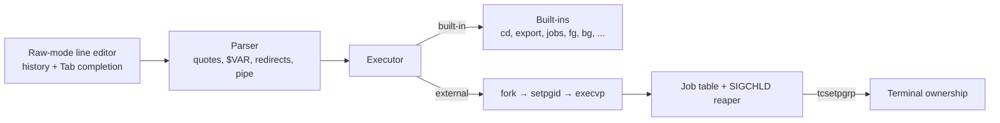

---
# Written from the Solaris-Shell repo, which now holds the modular Conch
# version (2026-10-23). The homepage card still describes the old
# single-file shell: update its title and summary to match. An asciinema
# recording would make a good video. Replace the placeholder cover, then set
# `draft: false`.
title: Conch
slug: solaris-shell
tagline: Interactive Unix shell in C with job control
tags: [C, POSIX, Unix, Systems Programming, Make, Docker]
role: Solo project
dates:
  start: 2025-07
status: in-progress
links:
  source: https://github.com/newwavejacob-web/Solaris-Shell
cover:
  src: ../../assets/projects/solaris-shell/cover.png
  alt: Conch shell title card (placeholder)
next:
  - Fix the known bugs from the audit, starting with the history-recall buffer overflow and the realloc leaks cppcheck reports.
  - Support `;`, `&&`, and `||`, then pipelines with more than two commands. Each already has an expected-failure test waiting.
  - Rename the GitHub repo to match the Conch name.
draft: true
---

## Overview

Conch is an interactive Unix shell written in C directly on POSIX process APIs. It runs programs from `PATH`, handles quoting, `$VAR` expansion, single pipes, and redirects (`>`, `>>`, `<`, `2>`), and does basic job control with `&`, `jobs`, `fg`, `bg`, and Ctrl+Z. It has arrow-key history, Tab completion, and a themed boot sequence. It's an interactive shell, not a POSIX `sh`: it has no scripting language, and the README lists exactly what it doesn't support.

## Architecture

The shell is nine C modules with matching headers, about 1,600 lines: the line editor, history, completion, parser, executor, pipes, jobs, built-ins, and prompt. A Makefile builds release and debug versions and runs the tests, valgrind, and cppcheck. A Docker image bundles the toolchain.

## What I built

All of it:

- The raw-mode line editor with a 100-entry history ring and Tab completion from a list of common commands and executables on `PATH`.
- The parser for quoted words, `$VAR` and `${VAR}` expansion, redirects, and pipes.
- Process execution with `fork`/`execvp`/`dup2`, and built-ins dispatched through a function-pointer table.
- Job control: process groups, terminal handoff, Ctrl+Z, and a `SIGCHLD` handler that reaps background jobs.
- A 38-case test suite and a valgrind leak check that runs the whole suite.

## Hard problems & decisions

### Job control means handing over the terminal

To let Ctrl+Z and Ctrl+C reach the program instead of the shell, each child goes into its own process group. The shell then gives that group the terminal with `tcsetpgrp` and takes it back when the job stops or exits. The shell ignores `SIGTSTP` itself, and children reset their signal handlers to the defaults before `exec`.

### Making the README match the code

The first README claimed "full POSIX compliance" and "no memory leaks". I audited every claim against the code. Things that weren't true moved into a Limitations section, and each missing feature became an expected-failure test that reports `XPASS` once it starts working. The leak claim is now backed by a `make memcheck` target that runs every test under `valgrind --leak-check=full` and fails on any leak.

## Results

The test suite passes on macOS (Apple clang, arm64) and Linux (Debian, gcc): 29 passed, 0 failed, and 9 expected failures for unsupported features. Under valgrind, every session in the suite ends with "All heap blocks were freed". The audit also found three bugs that are documented but not fixed yet.
