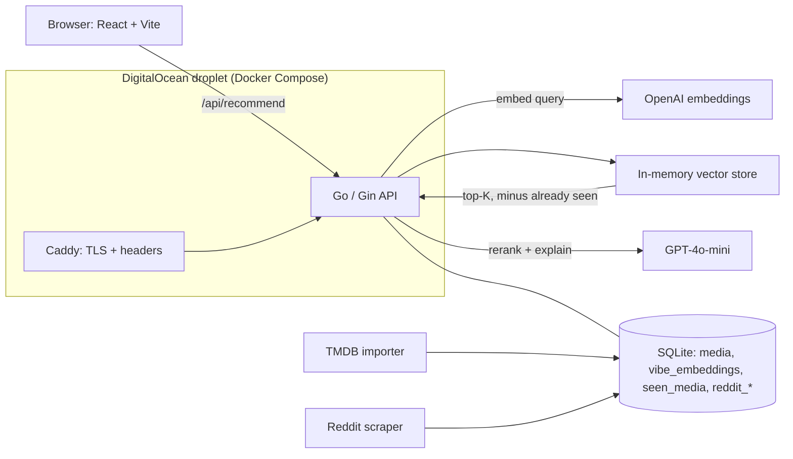

---
# Written from the repo, README, and AUDIT_FINDINGS.md (2026-10-23).
# what2watch.win didn't respond on 2026-10-23, so there's no live link yet.
# Add `live:` once the site is back, replace the placeholder cover with a
# screenshot, then set `draft: false`.
title: What 2 Watch
slug: what-2-watch
tagline: Movie, TV, and anime recommendations by mood instead of genre
tags: [Go, Gin, React, SQLite, OpenAI, Docker, Caddy]
role: Solo project. Deployment and infrastructure, with the recommendation engine built alongside Claude
dates:
  start: 2026-01
status: in-progress
links:
  source: https://github.com/newwavejacob-web/What-2-Watch
cover:
  src: ../../assets/projects/what-2-watch/cover.png
  alt: What 2 Watch title card (placeholder)
next:
  - Bring what2watch.win back up and add uptime monitoring.
  - Server-render the catalog so search engines see more than an empty React shell.
  - Learn from watch history and "not what I meant" feedback instead of only excluding seen titles.
  - Move from the in-memory vector scan to an approximate nearest-neighbor index once the catalog grows past a few thousand titles.
draft: true
---

## Overview

What 2 Watch recommends films, series, and anime by mood. You describe the feeling you want ("cozy small-town mystery with autumn vibes") instead of picking genres. Each title has a short vibe profile describing its tone, pacing, and look. The app embeds your query and the profiles with OpenAI and ranks titles by cosine similarity, then an LLM reranks the top results and explains each pick. The catalog holds 463 titles: 199 movies, 169 anime, and 95 TV series.

## Architecture

A search runs in five steps: embed the query with `text-embedding-3-small`, load the titles you've already marked as seen, scan the in-memory store for the closest vibe embeddings while skipping those titles, fetch the details from SQLite, and have GPT-4o-mini rerank and explain the results. A TMDB importer and a Reddit scraper (r/MovieSuggestions, r/animesuggest, r/televisionsuggestions) grow the catalog and adjust quality scores. It runs in Docker Compose on a DigitalOcean droplet behind Caddy, with Cloudflare in front.

## What I built

The backend wasn't the point; I already know how to write one. I started from a Go CRUD web app I'd built about three years earlier and used Claude to grow it into the recommendation engine quickly. What I wanted to learn was how to deploy, configure, and run a larger site myself:

- Containerizing the Go API and React frontend with a Dockerfile and Docker Compose.
- Running it on a DigitalOcean droplet behind Caddy for TLS and security headers, with Cloudflare DNS in front, alongside my other sites on the same machine.
- Designing the product: mood-based search, vibe profiles, a catalog grown from TMDB and Reddit, and LLM reranking with explanations.
- Auditing the running app for security and cost risks, then fixing what the audit found.

## Hard problems & decisions

### Vibes instead of genres

Genre tags and collaborative filtering answer "what's similar to this title?". People usually know the mood they want, not the title. Matching a free-text mood against a written profile of each title's tone lets a thriller and a drama with the same feel land next to each other.

### Brute-force search on purpose

SQLite can't do vector similarity, and the catalog is a few hundred titles. A linear cosine scan over embeddings held in memory takes well under a millisecond, with no extra service to run. Switching to an approximate index makes sense only once the catalog is in the thousands.

### Auditing my own app before exposing it

Before putting the site in front of people, I audited it. The worst findings were critical:

- `user_id` came from the client, so anyone could read or delete anyone's watch history.
- Every OpenAI-billed endpoint was public and unthrottled, so a stranger with `curl` could run up the bill.
- The vector store had no lock, so concurrent reads and writes would panic and take down the process.

The fixes: server-issued anonymous sessions in a signed httpOnly cookie, per-session rate limits on the billed routes, an admin secret on `/admin`, a read-write mutex on the vector store, and release mode with security headers, CSP, and CORS configured.

## Results

The recommender works end to end over a 463-title catalog. Search, reranking with explanations, and seen-title filtering all work. The three critical findings from the audit are fixed. The public site is currently down, so there's no live demo link yet.
